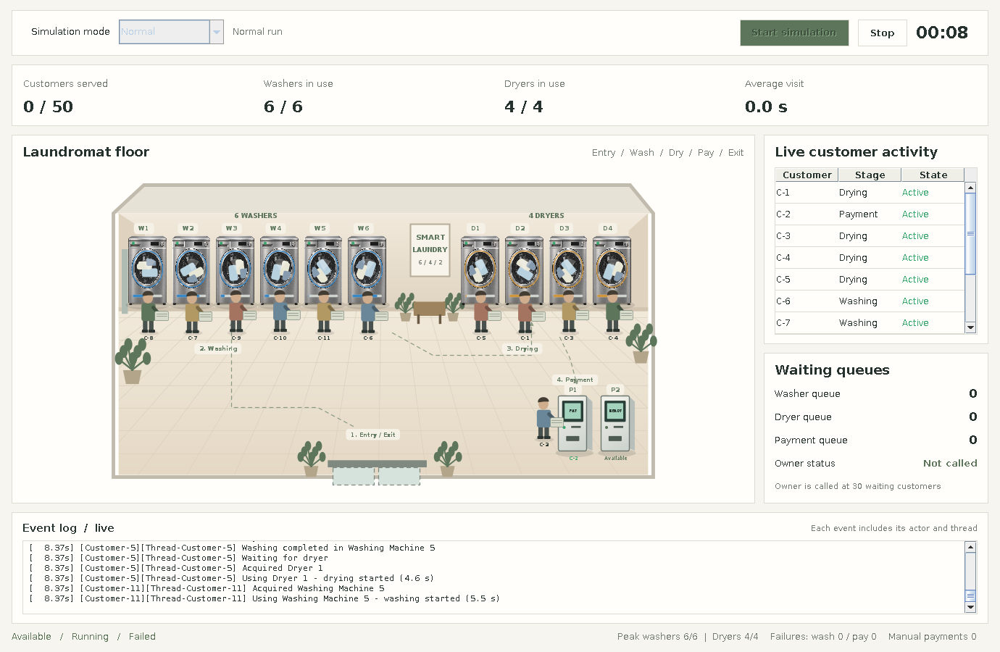

# Smart Laundry Simulation

**A Java multithreaded laundry-facility simulation with an interactive Swing/Java2D desktop GUI.**

The project models customers moving through washing, drying and payment while competing for a limited number of machines and kiosks. It demonstrates Java threads, synchronization, fair resource allocation, failure recovery, queues, animation, and live simulation statistics.

**Author:** [Suman Upreti](https://github.com/sumanupreti7)  
**Project type:** Java desktop simulation / concurrency project  
**Requirements:** JDK 17 or later, a terminal with Bash, and a graphical desktop for GUI mode



## At a glance

| Simulation component | Configuration |
| --- | --- |
| Customers | 50 individual customer threads |
| Washing machines | 6 shared washers |
| Dryers | 4 shared dryers |
| Payment kiosks | 2 shared kiosks |
| Scenarios | Normal and Congested |
| Interface | Java Swing and Java2D animation |
| Tests | 25 JUnit 5 tests |
| Java target | Java 17 |

## Key features

- **Concurrent customer processing:** Each customer independently completes a wash → dry → payment → exit sequence.
- **Resource coordination:** Fair semaphores and resource queues prevent more customers from using a machine than the available capacity permits.
- **Visual simulation:** Animated customers walk between laundry stages; washers and dryers show their operating states.
- **Two scenarios:** Regular operation with usable kiosks, or a congested scenario where both kiosks remain offline.
- **Failure handling:** Washing-machine failures and payment failures trigger resets or retries in the normal scenario.
- **Owner intervention:** During congestion, an owner is called when exactly 30 customers are waiting to pay and later opens a manual payment counter.
- **Live statistics and events:** Track throughput, resource usage, waiting customers, failure counts, and simulation progress.
- **Tests and documentation:** Source tests, an offline JUnit test runner, implementation notes, and animation documentation are included.

## Quick start: clone and run

### 1. Install prerequisites

Install **Java Development Kit (JDK) 17 or later**. On macOS or Linux, open Terminal and verify both the Java runtime and compiler:

```bash
java -version
javac -version
```

Both commands should report version **17 or newer**. A JRE alone is not sufficient because the supplied script compiles the source. You also need **Bash** (available on macOS and most Linux installations).

The GUI needs a desktop with graphical display support; use console mode on headless systems. On Windows, use a Bash-capable environment such as Git Bash or WSL with suitable GUI support, or run from an IDE configured for Java 17+.

### 2. Clone the repository

```bash
git clone https://github.com/sumanupreti7/SmartLaundrySimulation.git
cd SmartLaundrySimulation
```

### 3. Start the desktop simulation

```bash
bash run.sh
```

The Swing window opens. Choose **Normal** or **Congested**, then click **Start simulation**. Use **Stop** to cancel a run; allow controls to become available again before starting another.

The script compiles the Java sources into `build/classes`, copies the required assets, and launches `laundromat.Main`. You do **not** need Maven or an internet connection to run this script.

### Other run modes

Run each command from the repository root:

| Command | Result |
| --- | --- |
| `bash run.sh` | Open GUI and choose a scenario |
| `bash run.sh --normal` | Open GUI and begin the normal scenario |
| `bash run.sh --congested` | Open GUI and begin the congested scenario |
| `bash run.sh --console` | Run the normal scenario in Terminal (no GUI) |
| `bash run.sh --console --congested` | Run the congested scenario in Terminal |
| `bash test.sh` | Compile source/tests and execute JUnit tests |

To stop a console run early, press **Ctrl+C**. A completed run prints a summary of customers served, average customer time, maximum resources in use, failures, owner calls, and manual payments.

## How the simulation works

1. **Arrival:** A generator creates 50 customer threads with randomized gaps between arrivals.
2. **Washing:** Each customer waits for an available washer, completes a wash cycle, and handles potential failure/retry.
3. **Drying:** After releasing the washer, the customer waits for a dryer and completes a dry cycle.
4. **Payment:** The customer pays at a kiosk in the normal scenario or waits for the manual counter during congestion.
5. **Exit:** The customer finishes and the statistics are updated. The simulation completes after every customer has finished.

The customer holds at most one type of shared resource at a time. Semaphores enforce machine capacity; atomic counters and thread-safe state help keep statistics consistent. The GUI updates its Swing controls on the Event Dispatch Thread.

### Normal scenario

- All **6 washers**, **4 dryers**, and **2 payment kiosks** are available.
- Washer operations have a **5% failure probability per attempt** and a **two-second reset** on failure.
- Kiosk payments have a **5% failure probability per attempt**, with a **two-second retry delay**.
- Washing typically takes **4–6 seconds**, drying **3–5 seconds**, and kiosk payment **1–2 seconds**.

Probabilities are per attempt: a single run is not guaranteed to have exactly 5% failed operations.

### Congested scenario

- Both payment kiosks stay **offline for the entire run**.
- When **exactly 30 customers are waiting to pay**, the owner is called once.
- After **five seconds**, the owner opens a separate manual cash counter serving **one person at a time**.
- Each customer makes their own **one-second** manual cash payment. The kiosks are not repaired during this scenario.

This scenario generally takes longer than normal operation. A run finishes when all 50 customers have completed, rather than at a fixed deadline.

### Arrival timing assumption

Arrivals vary over **0–3 seconds**. By default, the program uses a biased distribution (`3000 × U²` milliseconds, with `U` uniform from 0 to 1), favoring shorter gaps to target roughly a one-minute normal run. To switch to uniform arrival delays after compiling the project with `bash run.sh`, use:

```bash
java -Dlaundry.uniformArrivals=true -cp build/classes laundromat.Main --console
```

This is an optional console demonstration, not a required setup step. Actual durations vary with random arrival and failure events.

## Testing

Run the included offline test suite:

```bash
bash test.sh
```

`test.sh` compiles the production and test sources, then runs JUnit using the bundled `tools/junit-platform-console-standalone.jar` file. The suite contains **25 JUnit tests** covering shared resources, payments, statistics, customer behavior, concurrency requirements, and movement logic.

Alternatively, if Maven is installed and dependencies can be downloaded, the project also includes `pom.xml`:

```bash
mvn test
```

## Project structure

```text
SmartLaundrySimulation/
├── src/
│   ├── main/java/laundromat/    # Simulation, GUI, resources, customer threads
│   └── test/java/laundromat/    # JUnit tests
├── assets/                     # Appliance sprite used by the GUI
├── documentation/
│   ├── IMPLEMENTATION.md       # Design, concurrency, verification, limitations
│   ├── ANIMATION.md            # Motion and GUI behavior
│   ├── VIDEO_GUIDE.md          # Explanation/demo recording outline
│   └── evidence/gui-running.png
├── tools/                      # Offline JUnit runner and notice
├── pom.xml                     # Optional Maven build/test configuration
├── run.sh                      # Compile and launch Java application
├── test.sh                     # Compile and run offline tests
├── COPYRIGHT.md               # Copyright and permitted-use notice
└── README.md                   # This guide
```

## Further documentation

- [Implementation, concurrency decisions, and tests](documentation/IMPLEMENTATION.md)
- [GUI animation and movement design](documentation/ANIMATION.md)
- [Demonstration video guide](documentation/VIDEO_GUIDE.md)

The GUI's floor represents active customers and a limited number of waiting figures. When queues are larger than the display can show, **queue counters and the activity table** provide the more complete picture.

## Troubleshooting

| Problem | What to check |
| --- | --- |
| `java: command not found` | Install JDK 17+ and make sure `java` is on your `PATH`. |
| `javac: command not found` | Install a **JDK**, not only a Java runtime, and check `javac -version`. |
| Compilation fails with older Java | Use JDK 17 or later (`javac --release 17` is used by the script). |
| `bash: run.sh: command not found` | Run `bash run.sh` from the project root, not `run.sh` by itself. |
| `src/main/java/laundromat/*.java` not found | Run the script from the cloned repository directory; don't copy only the script. |
| Swing window does not appear | Run on a computer with a graphical desktop, or use `bash run.sh --console`. |
| Simulation seems slow or waits | Customers are waiting for shared resources; congested runs take longer, and runs do not have a strict timeout. |
| JUnit runner missing | Confirm `tools/junit-platform-console-standalone.jar` exists and run `bash test.sh`. |

## Scope and limitations

This is a **local desktop simulation**, not a real laundry booking, payment, or production IoT system. Customer counts, resource capacity, timing, and failure probabilities are simulation parameters. The visual design is an illustrative Java2D recreation, and results may vary between runs.

## Author and copyright

Developed by **[Suman Upreti](https://github.com/sumanupreti7)**.

**Copyright © 2026 Suman Upreti. All Rights Reserved.**

This repository is publicly available as an educational reference and portfolio project. Visitors may study the implementation and evaluate it locally for personal, non-commercial educational purposes. Unauthorized redistribution, substantial reuse, commercial exploitation, or falsely claiming authorship of the original project is not permitted, subject to applicable law and GitHub's Terms of Service.

**This project is not distributed under an open-source license.** Third-party components retain their own licenses and copyright notices. See [COPYRIGHT.md](COPYRIGHT.md) for the full notice.
